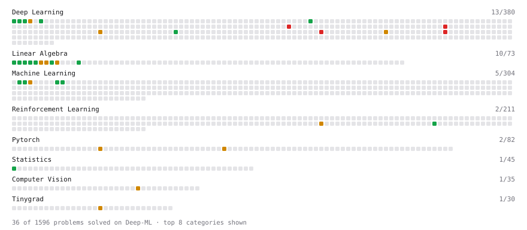

# Deep-ML

My machine learning practice from [Deep-ML](https://www.deep-ml.com). Every solution here was written by hand.

**45** solved · 45 problems · 0 labs · 0 math

[**Browse the interactive portfolio**](https://gurdjieff102.github.io/deep-ml/) to replay this filling in over time.

## Problems

| | Difficulty | Solved | |
| --- | --- | --- | --- |
| [Batch Iterator for Dataset](https://www.deep-ml.com/problems/30) | easy | 2026-09-04 | [solution](problems/0030-batch-iterator-for-dataset) |
| [Calculate 2x2 Matrix Inverse](https://www.deep-ml.com/problems/8) | easy | 2026-08-28 | [solution](problems/0008-calculate-2x2-matrix-inverse) |
| [Calculate Accuracy Score](https://www.deep-ml.com/problems/36) | easy | 2026-09-08 | [solution](problems/0036-calculate-accuracy-score) |
| [Calculate Covariance Matrix](https://www.deep-ml.com/problems/10) | easy | 2026-08-28 | [solution](problems/0010-calculate-covariance-matrix) |
| [Calculate Mean by Row or Column](https://www.deep-ml.com/problems/4) | easy | 2026-08-28 | [solution](problems/0004-calculate-mean-by-row-or-column) |
| [Compare Naive vs Stable Softmax for Attention Scores](https://www.deep-ml.com/problems/962) | easy | 2026-09-01 | [solution](problems/0962-compare-naive-vs-stable-softmax-for-attention-scores) |
| [Feature Scaling Implementation](https://www.deep-ml.com/problems/16) | easy | 2026-09-02 | [solution](problems/0016-feature-scaling-implementation) |
| [Gibbs Softmax Action Selection](https://www.deep-ml.com/problems/641) | easy | 2026-09-01 | [solution](problems/0641-gibbs-softmax-action-selection) |
| [Implement Precision Metric](https://www.deep-ml.com/problems/46) | easy | 2026-09-08 | [solution](problems/0046-implement-precision-metric) |
| [Implement ReLU Activation Function](https://www.deep-ml.com/problems/42) | easy | 2026-09-08 | [solution](problems/0042-implement-relu-activation-function) |
| [Implementation of Log Softmax Function](https://www.deep-ml.com/problems/39) | easy | 2026-09-01 | [solution](problems/0039-implementation-of-log-softmax-function) |
| [KL Divergence Between Two Normal Distributions](https://www.deep-ml.com/problems/56) | easy | 2026-09-05 | [solution](problems/0056-kl-divergence-between-two-normal-distributions) |
| [Leaky ReLU Activation Function](https://www.deep-ml.com/problems/44) | easy | 2026-09-05 | [solution](problems/0044-leaky-relu-activation-function) |
| [Linear Kernel Function](https://www.deep-ml.com/problems/45) | easy | 2026-09-05 | [solution](problems/0045-linear-kernel-function) |
| [Linear Regression Using Gradient Descent](https://www.deep-ml.com/problems/15) | easy | 2026-09-02 | [solution](problems/0015-linear-regression-using-gradient-descent) |
| [Matrix-Vector Dot Product](https://www.deep-ml.com/problems/1) | easy | 2026-08-28 | [solution](problems/0001-matrix-vector-dot-product) |
| [One-Hot Encoding of Nominal Values](https://www.deep-ml.com/problems/34) | easy | 2026-09-08 | [solution](problems/0034-one-hot-encoding-of-nominal-values) |
| [Random Shuffle of Dataset](https://www.deep-ml.com/problems/29) | easy | 2026-08-29 | [solution](problems/0029-random-shuffle-of-dataset) |
| [Reshape Matrix](https://www.deep-ml.com/problems/3) | easy | 2026-08-28 | [solution](problems/0003-reshape-matrix) |
| [Scalar Multiplication of a Matrix](https://www.deep-ml.com/problems/5) | easy | 2026-08-28 | [solution](problems/0005-scalar-multiplication-of-a-matrix) |
| [Sigmoid Activation Function Understanding](https://www.deep-ml.com/problems/22) | easy | 2026-08-29 | [solution](problems/0022-sigmoid-activation-function-understanding) |
| [Single Neuron](https://www.deep-ml.com/problems/24) | easy | 2026-09-02 | [solution](problems/0024-single-neuron) |
| [Softmax Activation Function Implementation ](https://www.deep-ml.com/problems/23) | easy | 2026-08-29 | [solution](problems/0023-softmax-activation-function-implementation) |
| [Thanksgiving Feast Predictor: Softmax for Dish Selection](https://www.deep-ml.com/problems/216) | easy | 2026-09-01 | [solution](problems/0216-thanksgiving-feast-predictor-softmax-for-dish-selection) |
| [Transformation Matrix from Basis B to C](https://www.deep-ml.com/problems/27) | easy | 2026-09-03 | [solution](problems/0027-transformation-matrix-from-basis-b-to-c) |
| [Transpose of a Matrix](https://www.deep-ml.com/problems/2) | easy | 2026-08-28 | [solution](problems/0002-transpose-of-a-matrix) |
| [Calculate Eigenvalues of a Matrix](https://www.deep-ml.com/problems/6) | medium | 2026-08-28 | [solution](problems/0006-calculate-eigenvalues-of-a-matrix) |
| [Derivative of Softmax](https://www.deep-ml.com/problems/219) | medium | 2026-09-01 | [solution](problems/0219-derivative-of-softmax) |
| [Implement a Transformer Encoder Block](https://www.deep-ml.com/problems/905) | medium | 2026-09-04 | [solution](problems/0905-implement-a-transformer-encoder-block) |
| [Implement a Vision Transformer (ViT) Image Encoder](https://www.deep-ml.com/problems/720) | medium | 2026-09-04 | [solution](problems/0720-implement-a-vision-transformer-vit-image-encoder) |
| [Implement Adam Optimization Algorithm](https://www.deep-ml.com/problems/49) | medium | 2026-09-08 | [solution](problems/0049-implement-adam-optimization-algorithm) |
| [Implement Adapter Bottleneck Layer for Transformer Fine-Tuning](https://www.deep-ml.com/problems/873) | medium | 2026-09-04 | [solution](problems/0873-implement-adapter-bottleneck-layer-for-transformer-fine-tuning) |
| [Implement Masked Self-Attention](https://www.deep-ml.com/problems/107) | medium | 2026-09-08 | [solution](problems/0107-implement-masked-self-attention) |
| [K-Means Clustering](https://www.deep-ml.com/problems/17) | medium | 2026-09-02 | [solution](problems/0017-k-means-clustering) |
| [Matrix times Matrix ](https://www.deep-ml.com/problems/9) | medium | 2026-08-28 | [solution](problems/0009-matrix-times-matrix) |
| [Matrix Transformation ](https://www.deep-ml.com/problems/7) | medium | 2026-08-28 | [solution](problems/0007-matrix-transformation) |
| [Numerically Stable Softmax](https://www.deep-ml.com/problems/1227) | medium | 2026-09-01 | [solution](problems/1227-numerically-stable-softmax) |
| [Parallel Attention and FFN Transformer Block](https://www.deep-ml.com/problems/1043) | medium | 2026-09-04 | [solution](problems/1043-parallel-attention-and-ffn-transformer-block) |
| [Policy Gradient with Softmax Action Selection](https://www.deep-ml.com/problems/616) | medium | 2026-09-01 | [solution](problems/0616-policy-gradient-with-softmax-action-selection) |
| [Single Neuron with Backpropagation](https://www.deep-ml.com/problems/25) | medium | 2026-09-03 | [solution](problems/0025-single-neuron-with-backpropagation) |
| [Tinygrad: Implement a Transformer Encoder Block](https://www.deep-ml.com/problems/926) | medium | 2026-09-04 | [solution](problems/0926-tinygrad-implement-a-transformer-encoder-block) |
| [Build a Transformer Encoder Layer](https://www.deep-ml.com/problems/491) | hard | 2026-09-04 | [solution](problems/0491-build-a-transformer-encoder-layer) |
| [Implement a Spatiotemporal Transformer Block](https://www.deep-ml.com/problems/700) | hard | 2026-09-04 | [solution](problems/0700-implement-a-spatiotemporal-transformer-block) |
| [Implement Cross-Layer KV Sharing in Transformer](https://www.deep-ml.com/problems/1020) | hard | 2026-09-04 | [solution](problems/1020-implement-cross-layer-kv-sharing-in-transformer) |
| [Pre-Norm GPT Transformer Block Forward Pass](https://www.deep-ml.com/problems/1056) | hard | 2026-09-04 | [solution](problems/1056-pre-norm-gpt-transformer-block-forward-pass) |

---

_This file is regenerated by Deep-ML on every push._
